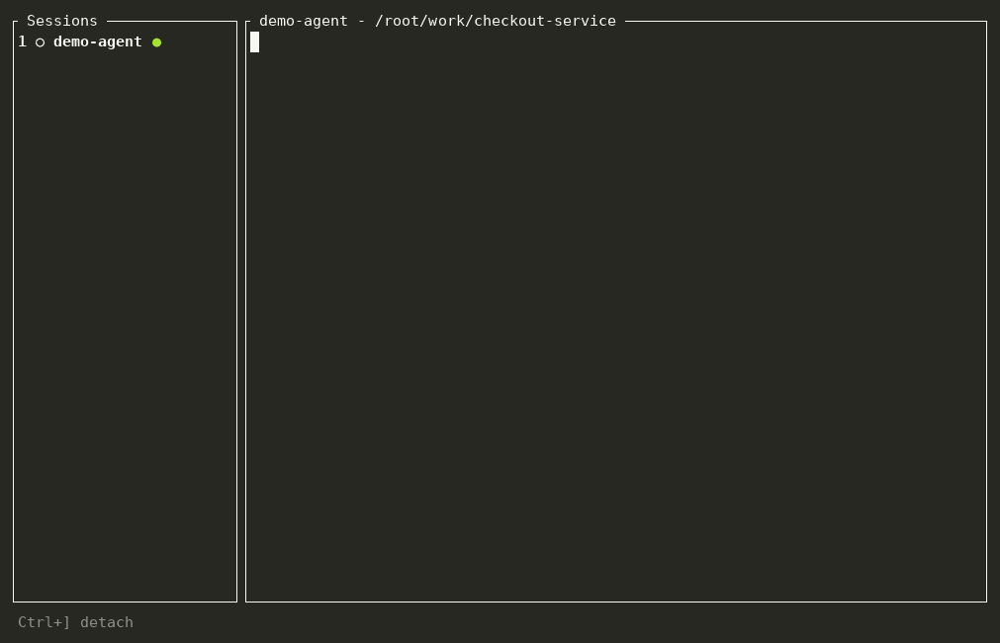

# Sakshi

**The witness for your AI coding agents.**

Sakshi (साक्षी, Sanskrit for "the witness") runs and supervises AI coding agents from one terminal. It supports Claude Code and Codex. See what every agent is doing, get notified when one needs you, and know at a glance whether its work can be trusted.



<sub>An agent is asked to fix failing tests. It skips the test, deletes the assertions and lowers the coverage gate, then reports "All tests pass". Sakshi turns the session red and says exactly why. (Recorded with a scripted stand-in agent so it is reproducible; see <a href="scripts/demo">scripts/demo</a>.)</sub>

> Status: 0.3, early. It works and is tested on macOS, Linux and Windows, but it is young, and the trust rules are heuristics (see [TRUST.md](TRUST.md)).

## Why
Running agents is easy. Knowing what they did is not. Sakshi watches each session and tells you when something looks off: tests skipped or deleted, assertions weakened, sensitive files touched, destructive commands run.

## Install

**Homebrew (macOS and Linux):**

```sh
brew install maxsignalhq/tap/sakshi
```

**Scoop (Windows):**

```powershell
scoop bucket add maxsignalhq https://github.com/maxsignalhq/scoop-bucket
scoop install sakshi
```

**macOS and Linux, install script:**

```sh
curl -fsSL https://raw.githubusercontent.com/maxsignalhq/Sakshi/main/install.sh | sh
```

**Windows (PowerShell):**

```powershell
irm https://raw.githubusercontent.com/maxsignalhq/Sakshi/main/install.ps1 | iex
```

Both scripts download the build for your machine from the latest GitHub release, check its SHA-256 against the published checksum, and install `sakshi` to `~/.local/bin` (Windows: `%LOCALAPPDATA%\Programs\sakshi`, added to your user `PATH`). Read them first if you like; they are short. Set `SAKSHI_VERSION=v0.1.0` to pin a version or `SAKSHI_INSTALL_DIR` to choose the folder.

**By hand:** release archives for macOS (Apple Silicon and Intel), Linux (x86-64 and ARM64, glibc) and Windows (x86-64 and ARM64) are attached to each [GitHub release](https://github.com/maxsignalhq/Sakshi/releases) with a `SHA256SUMS` file. Unpack one and put `sakshi` on your `PATH`.

> **macOS note:** release binaries are not yet notarized by Apple. The install script is unaffected, but if you download an archive with a browser, macOS may refuse to open `sakshi`. Clear the download flag once with `xattr -d com.apple.quarantine ./sakshi`.

**From source**, with a recent stable [Rust](https://rustup.rs):

```sh
cargo install --git https://github.com/maxsignalhq/Sakshi sakshi
```

The Homebrew, Scoop and winget manifests are generated from templates in [packaging/](packaging/). The winget package is not published yet. Publishing a release to the package managers is a manual step, described in [docs/RELEASING.md](docs/RELEASING.md).

Optional: `git` on your `PATH` enables change tracking, and desktop notifications use your OS's own notification service.

## Use

```sh
sakshi                       # start your shell inside Sakshi
sakshi claude                # start Claude Code inside Sakshi
sakshi claude --resume       # arguments after the program go to the program
```

Sakshi shows a session list on the left and the selected session's terminal beside it. Agents run exactly as they would in any terminal; Sakshi only watches.

**Attached** (typing into a session): everything goes to the program. The one key Sakshi keeps is **Ctrl+]**, which detaches you back to the list. **Shift+PgUp / Shift+PgDn** scroll back through the session's output; typing or pasting returns you to the live screen. Pasting, including several lines at once, works: programs that ask to be told about pastes get them marked as pastes, so a pasted newline is text and not Enter.

**On the list:**

| Key | Does |
|-----|------|
| `up` / `down`, `j` / `k` | Select a session |
| `Enter`, `l`, `1`-`9` | Attach (the digit jumps straight to that session) |
| `n` | Start a new shell |
| `c` | Start Claude Code (shown only when it is installed) |
| `o` | Start Codex (shown only when it is installed; see [Codex](#codex)) |
| `PgUp` / `PgDn`, `End` | Scroll the selected session's output back and forward; `End` returns to the live screen |
| `t` or `Tab` | Show or hide the details panel |
| `r` | Refresh the change summary |
| `x` | Close the session and kill its process (press twice) |
| `q` | Quit (press twice while sessions are running) |

Sessions keep running while you are on the list or in another session. They end when Sakshi exits.

### What it tells you

- **State** per session: `○` idle, `●` working, `!` needs you, `✓` done, `✗` failed. For Claude Code and Codex this is live, from their hooks. Other programs show only running or ended.
- **Notifications** when a session you are not looking at needs you, finishes or fails, or turns red. `--no-notify` turns them off.
- **Isolation, if you want it.** `sakshi --worktree claude` checks out a new branch (`sakshi/<id>`) from `HEAD` into a sibling folder and runs the session there, so parallel agents do not trample each other or your checkout. Uncommitted changes are not carried over. When you quit, Sakshi prints the commands to merge or drop the branch; it never merges or deletes anything itself.
- **Trust badge** (a coloured dot): green, yellow or red, with plain-English reasons in the details panel. See [TRUST.md](TRUST.md) for every rule.
- **While you were away**: re-attach to a session that did things while you were gone and Sakshi summarises them first.

### Looking back

Every session is recorded to a local log. Afterwards:

```sh
sakshi sessions                      # what ran, newest first, with state and trust
sakshi report                        # Markdown report of the latest session
sakshi report 0123abcd --format json # a specific session (any unique prefix of its id), as JSON
sakshi report --format pr            # a short block to paste into a pull request description
sakshi replay --speed 10             # replay the timeline at 10x
```

### Your own rules

Flag paths that matter in your codebase, or quiet ones that don't, with an optional `config.toml`:

```toml
[trust]
sensitive_paths = [{ pattern = "src/ledger/**", severity = "alert" }]
ignore_paths = ["fixtures/**"]
```

[TRUST.md](TRUST.md#your-own-rules) has the details and where the file lives on each OS.

## Codex

Codex runs only hooks you have approved, so it needs a one-time setup:

```sh
sakshi setup codex           # asks first, then registers a small plugin via Codex's own CLI
```

Then start Codex inside Sakshi (`o`, or `sakshi codex`) and, when it says hooks need review, choose **Trust all and continue**. `sakshi setup codex --status` shows whether it worked and `sakshi setup codex --remove` undoes it. The plugin does nothing unless Codex is running inside Sakshi. Without setup Codex still runs here, but shows only running or ended and the session turns yellow with a `hooks-silent` finding. Sakshi starts Codex with `--no-daemon`, so each session has its own app server rather than Codex's shared background one (which would not know which Sakshi session its hooks belong to). The cost: those sessions do not appear in `codex agents` or other clients of the shared server. Sakshi puts its own folder on the `PATH` it gives Codex, so the hook finds `sakshi` even when it is not installed on your `PATH`. Setup is not available on Windows yet. Details are in [PROTOCOL.md](PROTOCOL.md).

## Claude Code

When Sakshi starts `claude`, it adds `--settings <file>` with hooks that report back to Sakshi. Your own Claude Code settings are never modified, and if Sakshi is not running the hooks do nothing and cannot slow the agent down. If the hooks ever go quiet while Claude Code is clearly busy, the session turns yellow with a `hooks-silent` finding, so you know the badge can't see everything. The details are in [PROTOCOL.md](PROTOCOL.md).

## Privacy

Everything stays on your machine. Sakshi has no accounts, no telemetry and makes no network calls. Hooks talk to Sakshi over a local Unix socket (owner-only permissions) or a Windows named pipe (remote clients rejected). Activity logs live in:

| OS | Location |
|----|----------|
| Windows | `%LOCALAPPDATA%\maxsignalhq\sakshi\data` |
| macOS | `~/Library/Application Support/dev.maxsignalhq.sakshi` |
| Linux | `~/.local/share/sakshi` |

Logs are readable by your user only (on Unix), and the commands in them have obvious secrets masked: bearer tokens, `--token` and `--password` values, `NAME_SECRET=...` style assignments, well-known key shapes such as GitHub, Anthropic and AWS keys, and passwords inside URLs. That masking is a safety net, not a guarantee: a secret in an unusual shape, or a quoted value containing spaces, can get through, so treat the log directory as sensitive. Set `SAKSHI_DATA_DIR` to put them elsewhere, or pass `--no-log` to record nothing. Diagnostics go to `sakshi.log` in the same directory (`SAKSHI_LOG=debug` for more).

## Limits worth knowing

- Sessions do not survive Sakshi exiting or its terminal closing; there is no background daemon.
- Trust findings are pattern matches over commands, file paths and diffs. They look inside `bash -c`, `cmd /c`, `powershell -Command`, `sudo`, `env` and `xargs`, and they do not treat quoted text as a command, but they will still miss things (a script file that runs `rm -rf /`, say) and sometimes cry wolf. Treat a badge as a prompt to look.
- Scrolling back uses the keyboard; the mouse wheel is not captured. How much history is kept is limited (1,000 rows per session).
- On Windows the console reports a paste as a burst of key presses. Sakshi recognises a burst of eight or more characters containing a line break as a paste, so a very short multi-line paste can still be typed line by line.
- Agents running inside WSL cannot reach Sakshi's Windows pipe, so they show only running or ended. Run Sakshi inside WSL instead, where it behaves as on Linux.
- Change tracking needs a git repository. Work you had uncommitted before a session started is not blamed on it.
- Live state exists for Claude Code and Codex. Codex test runs have an unknown pass/fail unless Codex reports an exit code. Adapters for other agents are the natural next step; the [protocol](PROTOCOL.md) is small on purpose, and [docs/ADAPTERS.md](docs/ADAPTERS.md) shows how to add one.

## Develop

```sh
cargo fmt --check
cargo clippy --all-targets -- -D warnings
cargo test
python3 -m unittest discover -s packaging
```

Contributions are welcome: see [CONTRIBUTING.md](CONTRIBUTING.md), and please report vulnerabilities privately as described in [SECURITY.md](SECURITY.md). [SPEC.md](SPEC.md) describes the design and [CLAUDE.md](CLAUDE.md) the working rules. The workspace is `core` (model, events, trust engine; no UI or OS code), `pty`, `ipc`, `adapters`, `git`, `store`, `tui` and `cli`.

## License
[MIT](LICENSE)
